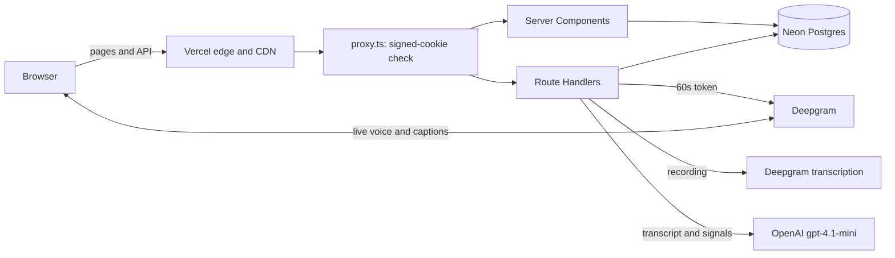

# yapper.ai

An AI speaking coach for the moments that matter at work: introducing yourself, giving updates, defending your work, telling stories and negotiating. You watch a short lesson, practice out loud with a voice coach, and get a scored report. After every practice, your skill profile updates across five areas: Fluency, Pronunciation & Articulation, Grammar & Syntax, Vocabulary and Cohesion.

Live demo: [yapper-ai-lilac.vercel.app](https://yapper-ai-lilac.vercel.app)

## Courses

The learning path has five courses. Each one starts with a level check, then 10 video lessons with voice practices between them, and ends with a final practice.

| # | Course | What you practice |
| --- | --- | --- |
| 1 | Introduce Yourself & Your Work | 30-second intro, "So what do you do?", tell me about yourself, elevator pitch |
| 2 | Speak Up: Status Updates & Public Speaking | Headline-first updates, delivering a delay, opening and presenting a talk |
| 3 | Hold Your Ground: Defend Your Work Under Pushback | Answering challenges, hostile questions, defending a budget, unfair feedback |
| 4 | Make It Stick: Storytelling with Impact | Origin story, turning points, customer stories, pitching with a story |
| 5 | Ask for What You're Worth: Negotiation | Stating your value, asking for a raise, handling a no, countering an offer |

**Free vs. Pro.**
- Without a plan, lesson 1 of every course and every level check are free.
- Practices are free only in course 1, for 3 attempts in all.
- Every other lesson and practice needs a Monthly or Annual plan.

**About the course lengths.** The lessons are public YouTube videos, each under 20 minutes, that we picked for this Business Cup demo because we don't have our own course material yet. The "10+ hours" to "20+ hours" lengths shown on each course are deliberate placeholders, not the sum of these videos. They reflect what we're aiming for: a production version would replace the YouTube lessons with 10+ hours of original material per course.

## Tech stack

| Layer | What we use | Why |
| --- | --- | --- |
| Web app | **Next.js 16** (App Router, React 19 Server Components), **TypeScript** | Pages render on the server next to the database, so screens arrive with data already in them and almost no client JavaScript |
| Styling | **Tailwind CSS 4**, CSS design tokens, Lucide icons | One token set gives light and dark themes and consistent spacing |
| API | Next.js Route Handlers (`frontend/app/api`) | One codebase and one deploy; every route runs as its own serverless function |
| Database | **Neon** serverless Postgres + **Drizzle ORM** | Typed schema and queries, autoscaling compute, pooled connections |
| Live voice | **Deepgram Voice Agent** (`nova-3` listen, `gpt-4o-mini` think, Aura-2 voices) + `nova-2` live captions | Low-latency, two-way voice conversation in the browser |
| Scoring | Deepgram pre-recorded `nova-2` (keeps filler words) + **OpenAI `gpt-4.1-mini`** structured output (Zod schema) | Real filler counts, pace and recognizer confidence, plus a report the code can check |
| Hosting | **Vercel** (functions in `iad1`, the same region as the database) | Global CDN for static assets; functions scale out automatically |

## Backend design

### Overview

The repo is one npm-workspaces monorepo with two packages:

- **`frontend/`** has the Next.js app: pages, UI components, API routes and the auth proxy.
- **`backend/`** has framework-free domain logic that the app imports as `backend/...`: the database schema and queries, scoring, the skill profile, coach prompts, course state, plans and onboarding. It has no Next.js dependency, so it can move into its own service later without a rewrite.

### Practice pipeline

1. **Start.** `GET /api/voice/token` checks the daily quota (30 practices a day) and the plan, then mints a 60-second Deepgram token. API keys never reach the browser.
2. **Talk.** The browser opens the Voice Agent with a coach prompt built per practice from the lesson, goal, pass criteria and what the coach remembers about the user. On the same mic stream it runs `nova-2` live transcription for captions and live filler counts.
3. **Score.** `POST /api/practice/score` receives a 32 kbps recording, then:
   - transcribes it with filler words kept, and measures pace, long pauses and per-word recognizer confidence;
   - asks `gpt-4.1-mini` for one structured report: answer-structure parts, 3 delivery scores, **5 skill scores**, 3 tips, an improved answer and a coach line. The model gets the measured delivery numbers, so it scores fluency and articulation from evidence rather than guessing from text;
   - scales scores by how much of a full answer was given, so a two-word answer can't score well;
   - falls back to a built-in heuristic scorer if the LLM is unavailable.
4. **Remember.** In the same request, the practice result, step progress, streak, a short coach note and the updated **skill profile** are written to Postgres. The recording itself is never stored.

### Skill profile

The profile is stored in `user_context.skills` and covers Fluency, Pronunciation & Articulation, Grammar & Syntax, Vocabulary and Cohesion.

- Your first practice sets the baseline.
- After that, each practice moves the profile toward its scores, weighted by how complete the answer was: a full answer moves it up to 35%, and a few words barely move it. One bad try can't erase weeks of progress, and steady practice shows up quickly.
- The previous values are kept, so the Progress tab can show what changed.
- The coach prompt includes the profile, so the voice coach knows your strongest and weakest skill.

### Data model

| Table | Holds |
| --- | --- |
| `users` | Name, streaks, plan, onboarding state |
| `user_context` | Onboarding answers, coach notes, skill profile: the coach's memory of you |
| `courses`, `steps` | All course content (lessons, level checks, practices, pass criteria), editable live in the database |
| `step_progress` | Per-user step status and best score; the current step is computed, never stored |
| `practice_sessions` | Every scored practice: scores, skills, transcript, tips, improved answer |
| `voice_attempts` | Started practices, for daily quotas and the free-plan limit |

### Security

- Name-only demo login. Sessions are HMAC-signed, httpOnly cookies, checked on every request by `proxy.ts`.
- Every query is scoped to the signed-in user's id.
- Inputs are validated with Zod, and uploads are size- and duration-capped.
- Secrets are read only on the server, and the browser only ever gets short-lived Deepgram tokens.

## UX and UI

- **Quick start.** Log in with just your name, answer a 4-question survey, pick a coach (Yap or Jensen, each with its own voice), and you're talking in your first free chat within a minute.
- **Feels like a real conversation.** A low-latency voice coach, an animated avatar that listens, talks and celebrates, live captions with filler words highlighted, and a live checklist of the pass criteria.
- **Feedback you can act on.** Every report has an overall score, per-dimension bars, 3 specific tips and a stronger version of your own answer that the coach can read aloud.
- **Progress you can see.** Animated skill bars count up after each practice, with arrows for what moved since last time, plus a streak, weekly minutes and a filler-rate trend.
- **Guided path.** A level check opens each course, lessons unlock in order, and locked steps explain exactly what's left to pass.
- **Polish.** Light and dark themes, skeleton loading screens on every page, responsive layouts from phone to desktop, and remembered microphone permission.
- **Accessible.** Semantic landmarks, ARIA labels on charts and progress bars, visible keyboard focus, and full support for `prefers-reduced-motion`.

## Scaling plan

### Today

The app is already built to scale horizontally:

- **Stateless servers.** Sessions live in signed cookies and all state lives in Postgres, so any function instance can serve any request.
- **Automatic scale-out.** Vercel runs each route as a serverless function and adds instances as traffic grows. Static assets come from the CDN.
- **Elastic database.** Neon autoscales compute (scaling up on its own) and pools connections, so a burst of function instances doesn't exhaust Postgres.
- **The heaviest work is outsourced.** Speech recognition, speech synthesis and LLM calls run on Deepgram and OpenAI, which scale on their side.

### Vertical vs horizontal scaling

| | Vertical (bigger machines) | Horizontal (more machines) |
| --- | --- | --- |
| Web and API | Not needed: functions are small and short-lived | Default: more function or container instances behind a load balancer |
| Postgres | First lever: raise Neon's compute ceiling | Read replicas for read-heavy pages (Progress, Courses); later, shard by `user_id` |
| Scoring workers | More CPU/RAM per worker for audio processing | A worker pool that scales with queue depth |

We scale **horizontally by default** because it has no ceiling and survives single-node failures. We use **vertical scaling only for the database**, where it is the cheapest first step.

### Roadmap as traffic grows

**Stage 1: up to ~10k monthly active users.** The current architecture.
- Add **Redis** (Upstash or ElastiCache) for:
  - rate limits and daily practice quotas (atomic counters instead of `COUNT(*)` queries);
  - caching course content, which every page reads and which rarely changes;
  - caching session-to-user lookups.
- Add observability: structured logs, traces, and dashboards for p95 latency per route and LLM/ASR cost per practice.

**Stage 2: ~10k to 100k monthly active users.**
- **Make scoring asynchronous with Kafka.** Today the score request waits about 5 to 10 seconds for transcription and the LLM. Instead:
  1. The API puts the recording in object storage (S3 or R2) and publishes a `practice.completed` event.
  2. The user sees "scoring…" and the report appears when it's ready.
  3. A worker pool consumes the events and scores them.
  4. Separate consumers update the skill profile, streaks, analytics and notifications.
  - This keeps traffic spikes from timing out requests, lets each consumer scale and retry on its own, and gives us a replayable event log for re-scoring and analytics.
- **Put a load balancer in front of the API.** Vercel's edge network does this today. If the API moves to containers (ECS or Kubernetes), an AWS ALB or NGINX spreads traffic across instances, with health checks and zero-downtime deploys.
- **Postgres read replicas** for dashboards and progress pages, and a dedicated connection pooler (PgBouncer).
- **Provider resilience:** retries with backoff, circuit breakers, and a second LLM and ASR provider for failover. The heuristic scorer is already a built-in fallback.

**Stage 3: 100k+ monthly active users.**
- **Multi-region:** edge-cached pages, regional API and worker clusters close to Deepgram and OpenAI endpoints, and Postgres replicas per region.
- **Split services along the existing `backend/` boundaries:** content, practice and scoring, profile and progress, billing. Each gets its own scaling policy.
- **Cost controls at scale:** cache LLM results for repeated prompts, batch non-urgent analytics, and route simple scoring to smaller models.
- **Analytics warehouse** (ClickHouse or BigQuery) fed from Kafka, so product analytics never load the main database.
